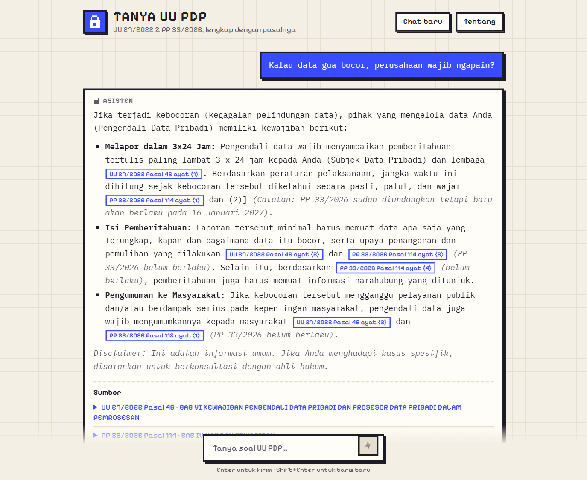
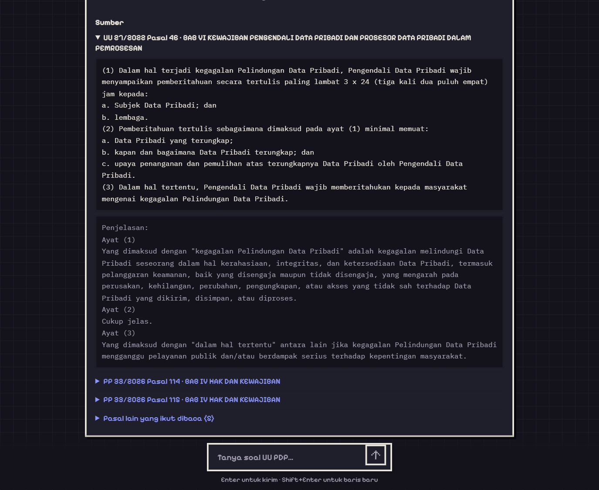
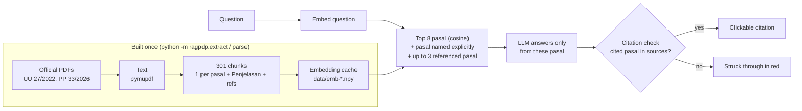

# Tanya UU PDP

**Live demo:** https://rag-pdp-regulation.vercel.app/ &nbsp; [](https://github.com/Sidqixx/rag-pdp-regulation/actions/workflows/ci.yml)

A RAG chatbot that helps laypeople understand Indonesia's personal data protection law: **UU 27/2022 (Pelindungan Data Pribadi)** and its implementing regulation **PP 33/2026**. Every answer cites the article (*pasal*) it is based on, and citations that do not appear in the retrieved sources are flagged automatically.

The UI and answers are in Indonesian, since the target users are Indonesian.

> Not legal advice. Conversations are not stored. The online version sends questions to a third-party LLM API; for fully offline use, run the local version (Ollama).

| Answer with clickable citations | Source articles (dark mode) |
|---|---|
|  |  |

## How it works



1. **Ingestion:** official PDFs → text (`pymupdf`) → one chunk per article, together with its official elucidation (*Penjelasan*) and the list of articles it references.
2. **Retrieval:** embeddings + cosine similarity (clearly beats BM25 and hybrid in the evaluation below). Articles mentioned by number ("Pasal 57") are fetched directly, and articles referenced by the top hits are pulled in. Embeddings: `gemini-embedding-2` (online) or local `bge-m3` (offline).
3. **Generation:** the LLM answers only from the retrieved articles, using a fixed citation format (`[UU 27/2022 Pasal N]`) that is verified in code. Two modes: **Gemini Flash-Lite** (free-tier API, fast) or **local qwen3.5:4b via Ollama** (fully offline).
4. **Evaluation:** 50 questions written in everyday Indonesian, each labeled with the correct articles.

## Evaluation

50 questions (44 answerable from UU/PP, 6 out of scope), see `eval/questions.jsonl`. The labels were reviewed manually.

**Retrieval** (`python -m ragpdp.evaluate`):

| Method | recall@5 | recall@8 | MRR |
|---|---|---|---|
| BM25 | 0.500 | 0.530 | 0.374 |
| Hybrid (BM25 + bge-m3, RRF) | 0.686 | 0.754 | 0.599 |
| Embedding `bge-m3` (local) | 0.833 | 0.924 | 0.766 |
| Hybrid (BM25 + gemini-embedding-2, RRF) | 0.712 | 0.777 | 0.635 |
| **Embedding `gemini-embedding-2` (online)** | **0.951** | **0.981** | **0.860** |

Hybrid search loses to pure embeddings with both models: laypeople rarely use the same words as the legal text, so BM25 mostly adds noise.

**Answers** (`python -m ragpdp.evaluate --answers`):

| Metric | **Production** (Gemini 3.5 Flash-Lite + gemini-embedding-2) | Gemini 3.5 Flash-Lite + bge-m3 | qwen3.5:4b + bge-m3 (local) | qwen3.5:2b + bge-m3 (local) |
|---|---|---|---|---|
| Answers with a citation | **42/44** | 43/44 | 38/44 | 37/44 |
| Cites a correct article | **42/44** | 41/44 | 35/44 | 27/44 |
| Contains a hallucinated citation (flagged red in the UI) | **0/44** | 0/44 | 2/44 | 6/44 |
| Refuses out-of-scope questions | 5/6 | 6/6 | 6/6 | 2/6 |
| Full answer time | ~15 s | ~15 s | ~45–55 s | ~20–25 s |

Local models were measured on a GTX 1650 (4 GB). The 2b numbers come from an earlier prompt version (re-scored with the same citation checker). LLM output varies between runs: an earlier 4b run scored 38/44 correct articles but 4/6 refusals, so differences of about ±3 questions are within noise.

### Failure analysis (production run)

Retrieval is not the bottleneck: for all 44 answerable questions, a correct article is in the top 8. All three failures happen in generation.

| Question | What went wrong | Cause | What changed |
|---|---|---|---|
| *Sidik jari dan rekam medis aku termasuk data yang dilindungi khusus nggak?* | Answer stopped mid-sentence ("…karena pem") before any citation | Generation: the provider ended the stream without a `finish_reason`. The correct articles were ranked 1st and 2nd, and the same prompt usually completes, so it is intermittent (about 4 of 70 streamed answers in follow-up testing) | When a stream ends without `finish_reason="stop"`, the server asks the model to continue, aligns the overlap so the text joins seamlessly (even mid-word), and only shows a "please ask again" notice if the continuation is cut off too (`resume_if_cut_off`, tested with real cut-offs) |
| *Akun gua kebobol hacker dari server sebuah startup, mereka wajib ngabarin gua kapan?* | Same: cut off mid-sentence | Same as above (correct articles ranked 1st and 2nd) | Same fix |
| *Gimana cara bayar tilang elektronik yang ketangkep kamera ETLE?* (out of scope) | Refused correctly, then added a note on CCTV rules citing UU 27/2022 Pasal 17 | Generation, borderline: the extra note is relevant (ETLE cameras are visual data processors) and correctly cited, but the metric counts any citation as "did not refuse" | Kept as is; the metric is deliberately strict |

Earlier failures shaped the current design: the local qwen models wrote citations in formats the first checker missed (e.g. "Pasal 120 ayat (1) UU No. 27 Tahun 2022", an article that does not exist), so the checker now also parses reversed and grouped citations.

## Running locally

Requires Python 3.12+.

```powershell
python -m venv .venv
.venv\Scripts\python.exe -m pip install -r requirements.txt
.venv\Scripts\python.exe -m uvicorn ragpdp.app:app --port 8000   # open http://localhost:8000
```

**Online mode (Gemini):** copy `.env.example` to `.env` and fill in a free API key from [Google AI Studio](https://aistudio.google.com). Chat (`CHAT_*`) and embeddings (`EMBED_*`) are configured separately. `.env` is git-ignored.

**Offline mode (Ollama):** without a `.env`, chat and embeddings run on [Ollama](https://ollama.com):

```powershell
ollama pull bge-m3
ollama pull qwen3.5:4b
```

Set `OLLAMA_CONTEXT_LENGTH=8192` before starting Ollama. The default of 4096 is too small, and longer prompts get truncated silently.

Rebuilding the data and measuring:

```powershell
python -m ragpdp.extract              # PDF -> data/text/*.txt
python -m ragpdp.parse                # text -> data/chunks.jsonl
python -m pytest
python -m ragpdp.evaluate             # retrieval
python -m ragpdp.evaluate --answers   # LLM answers (slow: 50 answers)
```

## Deploying for free (Vercel)

Vercel runs the FastAPI app as-is (root `app.py` is the entrypoint) on the free Hobby plan. The embedding cache (`data/emb-*.npy`) is committed, so the server never has to embed all 301 articles at startup.

1. Push this repo to GitHub.
2. In [Vercel](https://vercel.com/new), import the repository.
3. Under **Environment Variables**, paste the contents of your `.env`, then **Deploy**.

Each visitor (by IP) can ask 6 questions per minute and 40 per day, so one person cannot use up the shared free Gemini quota. The counter lives in memory per server instance, which is enough to stop casual spam but not a determined attacker.

## Continuous integration

GitHub Actions (`.github/workflows/ci.yml`) runs the unit tests on every push, then reruns the retrieval eval with the production embedding model and fails if recall@5 drops below 0.9. The eval job needs a `GEMINI_API_KEY` repository secret (**Settings → Secrets and variables → Actions**); without it, the job is skipped.

## Project layout

```
app.py             Vercel entrypoint
data/raw/          official PDFs
data/text/         extracted text
data/chunks.jsonl  one line = one article (+ elucidation, references)
data/emb-*.npy     embedding cache per model
ragpdp/            extract, parse, retrieve, answer, evaluate, app
web/index.html     chat UI
eval/              test questions + model answers
docs/LEARNING.md   study guide, design decisions, log (Indonesian)
```
